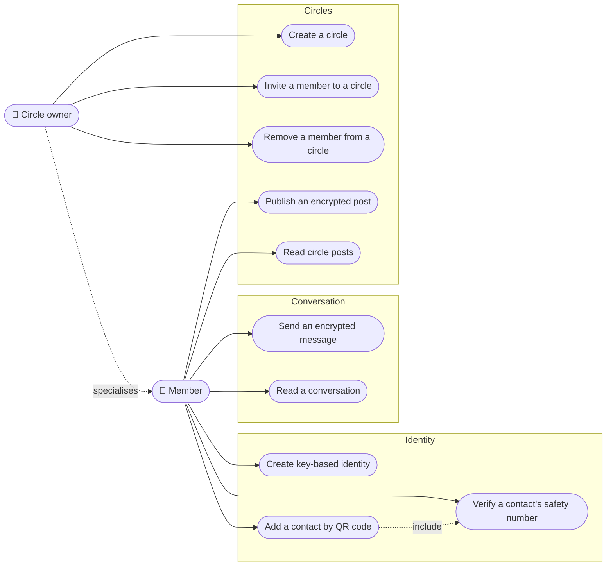

# Use-case diagram — e2e-messaging — MVP goals

> **Feature**: issue #37 — [MVP scope](../../../mvp-scope.md)

## Context

Actor goals for the MVP (identity, 1-1 chat, circles), grouped by domain.
Does not show which component implements them (see `02-component.md`).

## Diagram

## Notes

- Mermaid has no native use-case notation; ellipses (`([ ])`) stand for use cases.
- Receiving a message is a trigger, not a goal: it is covered by *Read a conversation*.
- The server is not an actor: it is a system component.
