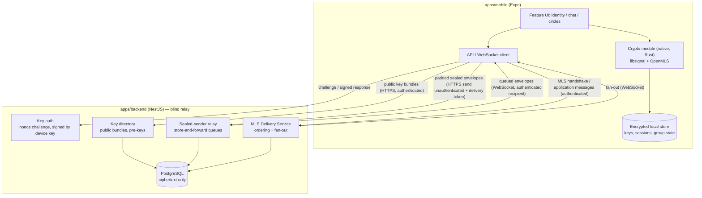

# Component diagram — e2e-messaging — blind-relay architecture

> **Feature**: issue #37 — [MVP scope](../../../mvp-scope.md)

## Context

Where encryption happens (device only) and what the server can see (ciphertext plus minimal
routing data). Does not cover media or backup (post-MVP).

## Diagram

## Notes

- Private keys and plaintext never cross the Mobile boundary; `Net` only carries ciphertext.
- Every endpoint is authenticated by the key-auth session except the relay's send endpoint,
  which accepts a delivery token instead so the sender stays hidden.
- The Delivery Service knows circle membership (accepted leak, see `mvp-scope.md`).
- The relay stores recipient id, timestamp and padded ciphertext — not the sender (sealed sender).
- `packages/shared` holds only wire types (envelopes, DTOs), no crypto.
