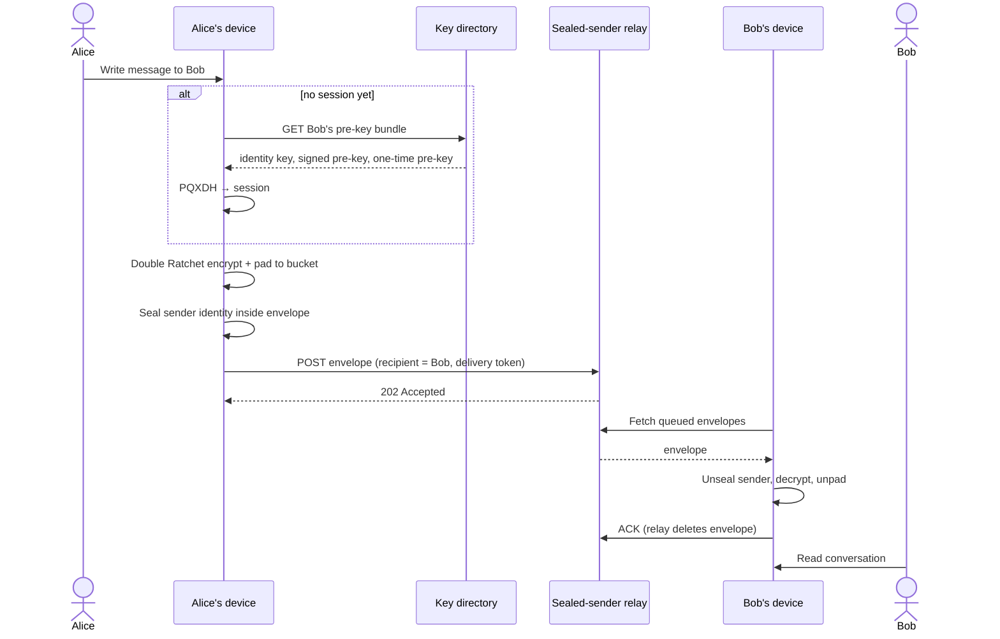
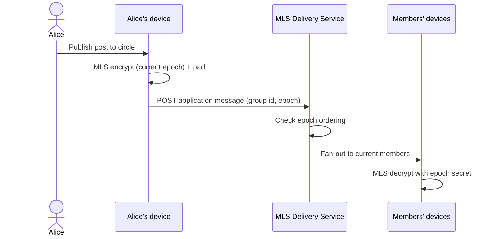

# Sequence diagram — e2e-messaging — 1-1 message and circle post

> **Feature**: issue #37 — [MVP scope](../../../mvp-scope.md)

## Context

Happy paths for *Send an encrypted message* (Signal, sealed sender) and *Publish an encrypted
post* (MLS). Error paths (exhausted pre-keys, MLS epoch conflicts) are left to later diagrams.

## Diagram — 1-1 message

## Diagram — circle post

## Notes

- The delivery token authorises the send without revealing the sender (Signal-style
  unidentified delivery).
- Removing a member creates a new MLS epoch: removed members cannot decrypt later posts.
